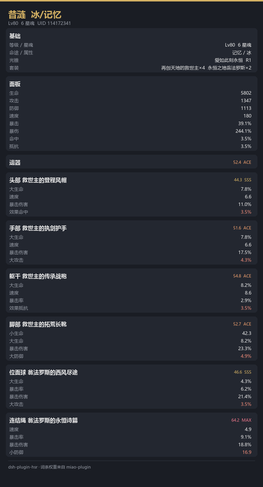

# dsh-plugin-hsr

给 [DeepSeek Harness](https://github.com/deepseek-ai) 用的**崩坏：星穹铁道**查询插件：
账号概览、角色面板、**遗器逐件评分与提升建议**。

遗器评分算法与词条权重表移植自 [miao-plugin](https://github.com/yoimiya-kokomi/miao-plugin)（MIT），
覆盖 106 个角色的专属权重。

---

## 能做什么

```
sr 查询         账号概览（等级、角色数、遗器评分总览）
sr 练度         全角色遗器评分排行
sr 昔涟面板     单角色面板
sr 昔涟遗器     遗器逐件评分 + 提升建议
sr 混沌         混沌回忆战绩（需要 Cookie）
sr 虚构         虚构叙事战绩（需要 Cookie）
sr 末日         末日幻影战绩（需要 Cookie）
```

在对话里直接说人话也行：「查一下我星铁的练度」「昔涟的遗器怎么样」。

### 出图

查询结果会同时渲染一张卡片显示在界面上（深色主题 + 评分配色）。
不想要图就传 `with_image: false`。



出图用 **Pillow**（本机渲染，无浏览器）：

- 有 Pillow 与中文字体 → 出 PNG
- 缺任何一个 → 自动退回纯文字，功能不受影响

相比 Playwright，不用下载 Chromium（省 150MB+），冷启动更快，也没有浏览器版本漂移问题。

### 评分会告诉你

- 每件遗器得分与评级（D / C / B / A / S / SS / SSS / ACE / MAX）
- **哪些副词条对你这个角色完全无效**（权重为 0）
- 主词条是否错配（头/手固定，不误报）
- 是否缺件

例：

```
【手部】天才的频变捕手  30.3 分 / S
    主词条 小攻击 352.8（权重 0）
    暴击伤害 18.8%  权重100
    效果抵抗 8.6%   权重50   · 权重偏低
    效果命中 7.8%   权重0    ✗ 无效
    击破特攻 6.5%   权重0    ✗ 无效
```

---

## 数据来源

分两条路，按有没有绑定 Cookie 自动选择：

| | mihomo 公开接口 | 米游社 Cookie |
|---|---|---|
| 需要登录 | 否 | 是 |
| 可见角色 | **仅游戏展柜** | **账号全部** |
| 战绩 | 无 | 有 |
| 风险 | 无 | 非官方接口，有风控 |

**没有 Cookie 也能直接用**，只是只能看到展柜里那几个角色。

绑定 Cookie：见 [docs/cookie.md](docs/cookie.md)

```bash
python service/tools/bind_cookie.py          # 交互式绑定
python service/tools/bind_cookie.py --list   # 查看已绑定
```

> Cookie 只写入本机 `service/data/hsr.db`，不上传、不写日志、不进 git。

---

## 安装

### 方式一：从源码装（推荐）

```bash
git clone https://github.com/<you>/dsh-plugin-hsr
cd dsh-plugin-hsr
```

然后在 DSH 里让 agent 装：

> 帮我把 `<clone 目录>` 用 plugin_manager install_bundle 装进当前 profile

或手动：

```bash
dsh plugin --profile <profile> add file:<clone 目录>
```

装完**完全退出并重开** DSH 桌面端。

### 前置条件

- **Python 3.9+** 在 PATH 里（`python --version` 能跑）
- **Node.js 22+**（DSH 本身的要求）

服务端只用 Python 标准库，**不需要 pip 装任何东西**。

出图是可选增强：装了 **Pillow** 就出卡片，没装只出文字。

```bash
pip install Pillow   # 可选，想要图卡再装
```

中文字体需要系统自带（Windows 的微软雅黑、macOS 的 PingFang、
Linux 的 Noto Sans CJK 都会自动识别）。

---

## 配置

`service/data/config.json`：

```json
{
  "expose_to_model": true,
  "command_prefix": "sr",
  "cache_ttl": 600
}
```

- `expose_to_model: false` —— 模型看不到工具定义（省上下文），只能用 `/sr` 命令
- `command_prefix` —— 斜杠命令前缀，逗号分隔可配多个
- `cache_ttl` —— 面板缓存秒数

插件配置在 `cordis.patch.yml`，主要是端口（默认 9778）。

---

## 直接用命令行

不想开 DSH 也能查：

```bash
python service/tools/query.py 查询
python service/tools/query.py 练度
python service/tools/query.py 昔涟遗器
```

---

## 评分口径

与 miao-plugin 一致：

- **单件**：`min(ret * (1 + fixPct) / 2 / pMax * 66, 70)`
  - `ret` = Σ(词条 mark × 数值)，主词条按 1/4 折算
  - `pMax` = 该部位在当前主词条下的理论满档分
  - `fixPct` 修正主词条与该角色的契合度
- **整套**：6 件之和 **÷ 6**（缺件直接扣分）
- **评级**：D<7，C<14，B<21，A<28，S<35，SS<42，SSS<49，ACE<56，MAX<70

权重含义：0 = 无用，50 = 次要，75 = 有用，100 = 核心。

---

## 已知限制

- **权重表是社区经验值**，不是官方数据。个别角色可能有争议
  （例如布洛妮娅、花火的暴伤权重较高，因为她们的辅助效果按自身属性结算）。
- 套装效果里**条件型加成**（需命中/入场触发的）不参与面板计算。
- 米游社接口是非官方的，官方改动后可能失效。
- 米游社通道需要在绑定 Cookie 后验证；只有 mihomo 通道经过完整验证。

---

## 开发

```bash
python tests/test_artifact.py         # 评分引擎单测
python service/hsr/server.py --port 9778   # 单跑服务
python scripts/harvest_miao.py        # 重新抓取 miao-plugin 权重表
```

### 目录

```
lib/                   DSH 插件入口（Node）
  index.js             注册工具与命令、拉起服务
  host/service.js      服务进程托管
  host/client.js       HTTP 客户端
  host/tool.js         工具定义
service/
  hsr/
    server.py          本地 HTTP 服务（标准库）
    commands.py        命令分发
    api/mihomo.py      mihomo 公开接口
    api/mys.py         米游社接口（含 DS 签名）
    core/artifact.py   评分引擎
    data/              词条权重表、套装数值
    store/db.py        SQLite
  tools/               bind_cookie.py / query.py
tests/                 单测
scripts/               开发脚本
docs/                  文档
```

---

## 许可

MIT。见 [LICENSE](LICENSE)。

遗器评分算法与词条权重表来自 miao-plugin（MIT），
游戏数据与商标归 miHoYo / HoYoverse 所有。本项目为非官方工具。
